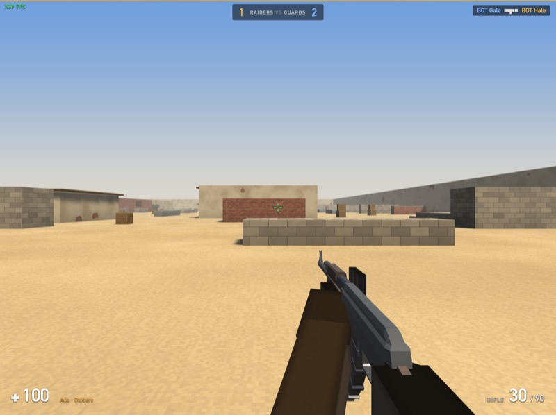
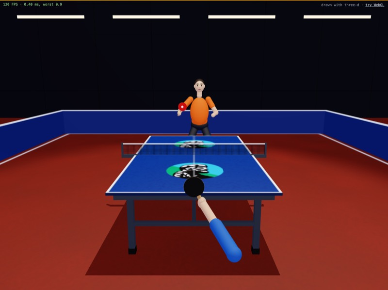
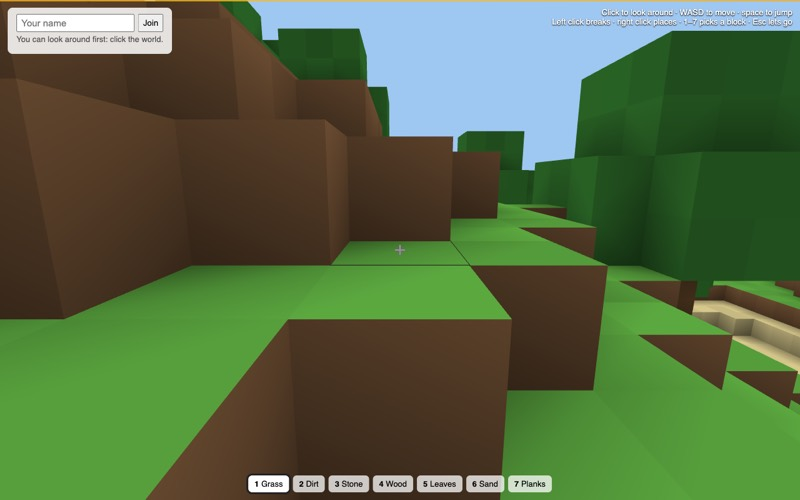
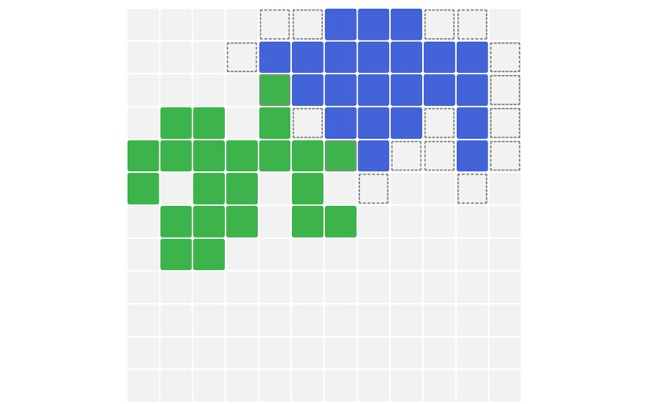

# Unscripted Laravel demo

Demo apps for [Unscripted](https://github.com/mattsplat/unscripted-js) components on
Laravel. A component is a PHP class and a Blade template, written the way you'd write a
Livewire one, but it **runs in the browser**: PHP 8.4 compiled to WebAssembly renders it there,
so clicks, typing and re-renders need no request. Only the methods marked `#[Server]` run on
Laravel, and the browser calls them.

The games go further: their engines are Rust compiled to WebAssembly and drawn with WebGL, with
Unscripted components around them for the menus, scoreboards and results.

## The apps

| Outpost | Rally | Voxel | Spread |
|---|---|---|---|
|  |  |  |  |

| Page | What it is | What it shows |
|---|---|---|
| [`/`](resources/views/landing.blade.php) | Unscripted's landing page: what it is, links to the docs and the examples | |
| [`/examples`](resources/views/home.blade.php) | Every example below, with screenshots | |
| [`/docs`](app/Http/Controllers/DocsController.php) | The components' docs, from `unscripted/ui-server`'s `docs/` folder | |
| [`/todos`](resources/components/todos.blade.php) | A todo list | Loaders (`#[Server, Watch]`), validation, permissions (`can:`), server rendering, live updates |
| [`/counters`](resources/components/counters.blade.php) | Counters in a parent | Nested components (`@child`), props, events, `Route::unscripted()` |
| [`/features`](resources/components/features.blade.php) | A checklist | The framework's features in one page, for checking in a browser |
| [`/spread`](resources/components/spread.blade.php) | A multiplayer board game: everyone paints one 12×12 board in 60-second rounds | Rules the server enforces and the browser previews; `#[Live]` boards on every player's page |
| [`/voxel`](resources/components/voxel.blade.php) | A shared block world (Rust, WebGL) | A Rust game and a PHP component talking through events; `Live::send()` for other players' moves |
| [`/outpost`](outpost/README.md) | A team shooter, with bots (Rust, WebGL, and a Rust game server) | An authoritative game server with client prediction; the HUD as a component |
| [`/rally`](resources/components/rally.blade.php) | Table tennis against the computer (Rust, WebGL) | Ball physics with spin, a computer player, results saved through a `#[Server]` method |
| `/rally-3d` | The same Rally, drawn with the [three-d](https://github.com/asny/three-d) crate | The same game (it shares `rally/src/sim.rs`) on a ready-made renderer, to compare looks, size and speed |

## Running it

```sh
composer install && npm install
cp .env.example .env && php artisan key:generate
touch database/database.sqlite && php artisan migrate

php artisan serve --host=0.0.0.0 --port=8010   # the pages
php artisan reverb:start --port=8081           # calls and live updates over a WebSocket
npm run outpost:server                         # only for Outpost: its game server
```

**[RUNNING.md](RUNNING.md)** has the details: what to install, the `.env` settings, rebuilding
the games, the tests, deploying to Laravel Cloud, and what to do when something doesn't work.

## What's where

| | |
|---|---|
| `resources/components/` | The Unscripted components, one `.blade.php` each: a PHP class, then its template |
| `resources/views/` | The pages that put them on, and the games' canvases and sounds |
| `voxel/`, `outpost/`, `rally/`, `rally3d/` | The games' Rust. Built into `public/wasm/` (committed, so deploys need no Rust) |
| `outpost/server/` | Outpost's game server, native Rust |
| `config/unscripted.php` | Which transport calls use (`http` or `reverb`), and where the runtime loads from |
| `database/migrations/` | Todos, Spread, Voxel and Rally's tables |

## The packages it uses

- [`unscripted/ui-server`](https://github.com/mattsplat/unscripted-ui-server) (Composer): the
  Laravel side, which serves components, renders them first and runs `#[Server]` methods.
  [Its docs](https://github.com/mattsplat/unscripted-ui-server/tree/main/docs) start with a
  quickstart and a guide for people coming from Livewire.
- [`@mtjncn/ui`](https://www.npmjs.com/package/@mtjncn/ui),
  [`@mtjncn/runtime`](https://www.npmjs.com/package/@mtjncn/runtime) and
  [`@mtjncn/php84`](https://www.npmjs.com/package/@mtjncn/php84) (npm): the framework, the
  browser runtime and PHP itself. The pages load them from jsDelivr.

All of them are developed in [unscripted-js](https://github.com/mattsplat/unscripted-js).

## License

MIT, as `composer.json` says.
